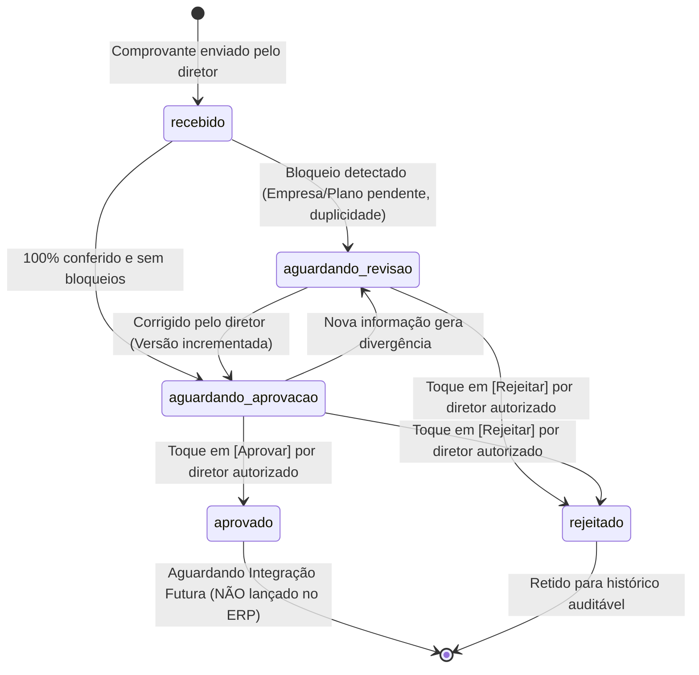

# LOGOS — EXPENSE-02: Relatório de Validação de Aprovação de Despesas pelo Telegram

**Data:** 17/10/2026 22:25  
**Branch:** `feature/cash-audit-fechamento`  
**Status:** CONCLUÍDO COM SUCESSO (22/22 testes offline aprovados, 608/608 na regressão completa)  
**Modo:** READ ONLY — Nenhuma chamada externa, nenhuma escrita ERP, `.env` não acessado, travas `WEBPOSTO_WRITES=0` e `LOGOS_ERP_ESCRITA=0` estritamente mantidas.

---

## 1. Missão e Resumo da Entrega

A missão do **EXPENSE-02** é implementar o fluxo de revisão e aprovação de despesas pelo Telegram com o mínimo de interação humana, seguindo a esteira:
**Enviar comprovante → extração → identificação → conferência automática → proposta pronta → aprovação com um toque → persistência auditável.**

O fluxo respeita os princípios fundamentais:
- **REUSE > ADAPT > CREATE**: Reutilizou a fila local, os adaptadores Gemini, o receptor Telegram já existente (`receber_comprovantes.py`) e modelos de dados do módulo `cash_reconciliation`.
- **Automatizar a preparação, NÃO a aprovação financeira**: Toda despesa aguarda decisão expressa do diretor autorizado.
- **Nenhuma escrita prematura no ERP**: Aprovar significa transicionar para `aprovado` (Aguardando Integração ERP), nunca `lancado_erp`.
- **Integridade de versão e concorrência**: Aprovações vinculadas a hash SHA-256 e versão exata do item da fila. Qualquer correção invalida a aprovação anterior e tickets vencidos/alterados são rejeitados atomicamente.

---

## 2. Componentes Reutilizados e Modificados

| Componente | Tipo | Papel no Fluxo EXPENSE-02 |
|---|---|---|
| `WebPosto_API/src/modules/cash_reconciliation/domain/comprovante.py` | Modificado | Adicionado enum `OperacaoFinanceira`, campos de auditoria de aprovação (`aprovado_por`, `aprovado_em`, `aprovado_versao`, `aprovado_hash`, `aprovado_operacao`), versionamento canônico, cálculo de hash SHA-256 da proposta (`calcular_hash_conteudo`) e motor de regras de bloqueio (`verificar_bloqueios_aprovacao`, `pode_ser_aprovado`). |
| `WebPosto_API/src/modules/cash_reconciliation/application/fila_despesas.py` | Modificado | `transicionar_status` reforçado: proíbe aprovação pelo sistema (`origem != "sistema"`), exige usuário humano identificado, valida inexistência de bloqueios (`EMPRESA_INDEFINIDA`, alertas de duplicidade), e registra metadados de aprovação e rejeição. |
| `WebPosto_API/src/modules/cash_reconciliation/application/processar_comprovante.py` | Modificado | Classificação automática da proposta nas 5 categorias financeiras conceituais (`NOVA_CONTA_A_PAGAR`, `DESPESA_JA_PAGA`, `TITULO_EXISTENTE`, `POSSIVEL_DUPLICIDADE`, `INDETERMINADO`), identificação amigável de contas financeiras (`conta_financeira_nome`), geração de conferências automáticas legíveis e hashing canônico da proposta. Suporte a incremento de versão e re-validação ao receber correções via texto. |
| `WebPosto_API/src/modules/cash_reconciliation/adapters/telegram_despesas.py` | Novo Adaptador | Criação de tickets opacos curtos (`desp:a:{ticket}`, `desp:c:{ticket}`, `desp:r:{ticket}`), persistência atômica SQLite de propostas com lock `BEGIN IMMEDIATE`, renderização de mensagens orientadas à decisão (com formatação BRL, datas `dd/mm/aaaa`, sem expor IDs internos ou dados bancários sensíveis) e processamento seguro de callbacks com autenticação estrita de diretores. |
| `WebPosto_API/src/jobs/receber_comprovantes.py` | Adaptado | Roteamento nativo de `callback_query` do Telegram para `atender_callback_despesa` quando prefixado com `desp:`. Envio imediato da proposta com botões inline `[ Aprovar ] [ Corrigir ] [ Rejeitar ]` no canal privado do diretor ao processar documento ou foto. |
| `WebPosto_API/src/shared/notificacao/telegram.py` | Adaptado | Suporte a `reply_markup` inline na função `enviar_mensagem`. |

---

## 3. Estados e Ciclo de Vida da Despesa

### Operações Financeiras Conceituais:
1. `NOVA_CONTA_A_PAGAR`: Despesa reconhecida, sem pagamento bancário comprovado. Sugestão: preparar conta a pagar no ERP (`POST /INTEGRACAO/V1/TITULOS_PAGAR`).
2. `DESPESA_JA_PAGA`: Débito bancário correspondente confirmado no extrato OFX (casamento por valor e janela de data). Sugestão: preparar lançamento direto em conta (`POST /INTEGRACAO/V1/MOVIMENTOS_CONTA`).
3. `TITULO_EXISTENTE`: Obrigação correspondente localizada entre os títulos em aberto no webPosto. Sugestão: preparar baixa do título (`PATCH /INTEGRACAO/V1/TITULOS_PAGAR/PAGAR`).
4. `POSSIVEL_DUPLICIDADE`: Despesa ou documento semelhante detectado. Bloqueia aprovação automática até revisão humana.
5. `INDETERMINADO`: Dados insuficientes ou conflitantes. Bloqueia aprovação automática até resolução.

---

## 4. Controles de Acesso e Segurança contra Comandos Telegram

- **Autenticação em Dois Níveis:**
  - `chat_id` validado contra a whitelist de canais autorizados (`TELEGRAM_CHAT_IDS` / `diretores_autorizados`).
  - `callback["from"]["id"]` validado contra IDs numéricos de diretores autorizados. Usuários não autorizados recebem recusa e exceção auditada.
- **Tickets Opacos Curtos no Callback Data:**
  - Callbacks no formato `desp:a:{ticket}` (aprovar), `desp:c:{ticket}` (corrigir), `desp:r:{ticket}` (rejeitar), onde `ticket` é um UUID hexadecimal de 8 caracteres.
  - Nenhum valor financeiro, conta completa ou dado sensível transita no `callback_data` do Telegram (respeitando o limite de 64 bytes da API do Telegram).
- **Anti-Replay e Concorrência Atômica:**
  - Persistência de tickets em SQLite local (`propostas_despesas`) com controle de transação `BEGIN IMMEDIATE`.
  - Transição de status do ticket (`pendente` → `executando` → `concluido`) realizada em operação atômica única `WHERE status = 'pendente'`.
  - Se duas decisões forem enviadas simultaneamente, apenas a primeira obtém a linha; a segunda falha imediatamente com `"Esta proposta já foi decidida"`.
- **Integridade de Versão e Hash Canônico:**
  - O ticket armazena `versao` e `hash_conteudo` (SHA-256 de campos-chave: valor, unidade, fornecedor, plano, operação, débito).
  - Se qualquer dado for alterado na proposta após a emissão do ticket, o callback de aprovação rejeita a ação com `"Esta proposta foi alterada e requer nova conferência"`.
- **Bloqueio de Aprovação Prematura:**
  - `pode_ser_aprovado` avalia se há bloqueios ativos. Propostas com `EMPRESA_INDEFINIDA`, alertas de duplicidade ou plano a classificar têm a aprovação rejeitada com mensagem clara explicando o motivo.

---

## 5. Fluxo de Correção com Mínima Interação

Ao clicar em `[ Corrigir ]`, o bot não exige formulários complexos e oferece opções rápidas em botões inline:
1. **Empresas Autorizadas:** Botões com os postos reais do grupo (Doze `74014`, VIP `11495`, Casa Caiada `5555`, Conv 24h `118508`).
2. **Classificação / Plano de Contas:** Principais naturezas de despesas operacionais (Pedreiro, Manutenção, Fardas e Uniformes, Material de Escritório).
3. **Efeito da Correção:**
   - Atualiza o campo correspondente na proposta.
   - Incrementa `versao = versao + 1`.
   - Recalcula o `hash_conteudo`.
   - Se os bloqueios forem sanados, transiciona de `aguardando_revisao` para `aguardando_aprovacao`.
   - Re-emite o ticket e atualiza a mensagem no Telegram com novos botões.

---

## 6. Fluxo de Rejeição

Ao clicar em `[ Rejeitar ]`:
1. Autentica a permissão do usuário.
2. Atualiza o status na fila local para `rejeitado`.
3. Registra usuário autenticado e timestamp ISO na trilha `historico_transicoes`.
4. O arquivo físico original do comprovante é preservado intacto em disco (nunca excluído).
5. O item é marcado como permanentemente bloqueado para futuros lançamentos no ERP.

---

## 7. Matriz de Testes Obrigatórios (22/22 Offline)

Arquivo: `WebPosto_API/tests/unit/cash_reconciliation/test_telegram_despesas.py`

| # | Cenário Testado | Resultado | Detalhe |
|---|---|---|---|
| 01 | Comprovante válido com todos os campos reconhecidos | **PASSED** | Proposta com empresa, valor formatado, plano sugerido e botões inline. |
| 02 | Empresa não identificada | **PASSED** | Bloqueia aprovação com `aguardando_revisao` e alerta "Empresa não identificada". |
| 03 | Fornecedor desconhecido | **PASSED** | Favorecido exibido como "A identificar", conferência aponta pendência. |
| 04 | Conta financeira indefinida | **PASSED** | Conta omitida quando sem débito, com operação `NOVA_CONTA_A_PAGAR`. |
| 05 | Despesa ainda não paga | **PASSED** | Sugere inclusão de título no ERP sem registrar quitação bancária. |
| 06 | Despesa já paga com evidência bancária | **PASSED** | Detecta débito no extrato OFX e classifica como `DESPESA_JA_PAGA`. |
| 07 | Título correspondente encontrado no ERP | **PASSED** | Cruza com títulos em aberto e classifica como `TITULO_EXISTENTE`. |
| 08 | Possível duplicidade | **PASSED** | Arquivo diferente com mesmo valor e data gera `POSSIVEL_DUPLICIDADE` e bloqueia aprovação. |
| 09 | Documento duplicado (SHA-256) | **PASSED** | Mesmo arquivo não gera novo item; referencia `duplicado_de_id`. |
| 10 | Aprovação por usuário autorizado (Um toque) | **PASSED** | Callback aprovado com sucesso, gravando versão, hash e usuário. |
| 11 | Aprovação por usuário não autorizado | **PASSED** | Rejeição imediata por checagem estrita de permissão de diretor. |
| 12 | Callback repetido (Anti-replay) | **PASSED** | Segundo callback do mesmo ticket falha por ticket já consumido. |
| 13 | Callback de versão antiga | **PASSED** | Alteração nos dados incrementa versão e rejeita ticket emitido para versão anterior. |
| 14 | Duas decisões simultâneas (Concorrência atômica) | **PASSED** | Lock atômico SQLite impede dupla decisão concorrente. |
| 15 | Correção de valor | **PASSED** | Alteração no valor modifica hash canônico e incrementa versão. |
| 16 | Correção de empresa | **PASSED** | Escolha de Posto VIP via botão atualiza unidade, desfaz pendência e avança versão. |
| 17 | Correção de classificação | **PASSED** | Escolha de plano de contas via botão sana bloqueio e avança versão. |
| 18 | Rejeição | **PASSED** | Transiciona para `rejeitado`, mantém documento original e registra histórico. |
| 19 | Reinicialização do serviço | **PASSED** | Fila recarregada do disco mantém dados íntegros e aceita aprovação posterior. |
| 20 | Compatibilidade com itens antigos da fila | **PASSED** | Registros legados sem hash/versão são lidos com segurança e nunca aprovados retroativamente. |
| 21 | Confirmação de aprovação sem escrita ERP | **PASSED** | Status final é `aprovado` (aguardando integração futura), nunca `lancado_erp`. |
| 22 | Ausência de qualquer chamada externa real | **PASSED** | 100% offline, zero chamadas HTTP (`httpx` mockado para falhar em qualquer request). |

---

## 8. Regressão Completa da Suíte de Testes

- **Comprovantes e Fila (`test_comprovantes_fila.py`):** 29/29 testes aprovados.
- **Telegram e Aprovações (`test_telegram_despesas.py`):** 22/22 testes aprovados.
- **Suíte Completa `tests/unit/cash_reconciliation/`:** **608 testes aprovados**, 0 falhas, 0 chamadas reais a portais ou ERP (`Isolamento Premmia: 0 tentativas reais de navegador/portal`).
- **Verificação de Sintaxe e Git:** `git diff --check` aprovado com código 0 (sem conflitos, sem trailing whitespace).

---

## 9. Limitações e Riscos

1. **Escrita no webPosto Pendente:** Esta sprint não cria adaptadores de escrita nem executa lançamentos. A aprovação autoriza o item para integração futura.
2. **Ambiente com Múltiplas Instâncias:** O banco SQLite `telegram.sqlite3` opera no mesmo volume local da fila. Para múltiplos nós de background, a fila deve ser migrada para PostgreSQL ou mantida em nó único coordenador.
3. **Backup Operacional:** A integridade de `fila.json` e `telegram.sqlite3` depende da preservação da pasta `WebPosto_API/data/despesas_avulsas/`.

---

## 10. Próximo Incremento (EXPENSE-03)

Com a esteira de captura, inteligência de conferência e aprovação com um toque 100% testada e segura:
1. Implementar adaptadores tipados de escrita ERP em modo de teste controlado (quando autorizado formalmente pelo dono).
2. Conectar as operações mapeadas na OpenAPI V1:
   - `POST /INTEGRACAO/V1/TITULOS_PAGAR` (Novas contas a pagar).
   - `POST /INTEGRACAO/V1/MOVIMENTOS_CONTA` (Despesas já quitadas em conta).
   - `PATCH /INTEGRACAO/V1/TITULOS_PAGAR/PAGAR` (Baixa de títulos existentes).
   - `POST /INTEGRACAO/V1/ARQUIVOS/{tipoOrigem}/{origem}` (Anexo do comprovante digital).
3. Transicionar o status de `aprovado` para `lancado_erp` somente após confirmação do ID retornado pela API do webPosto.
